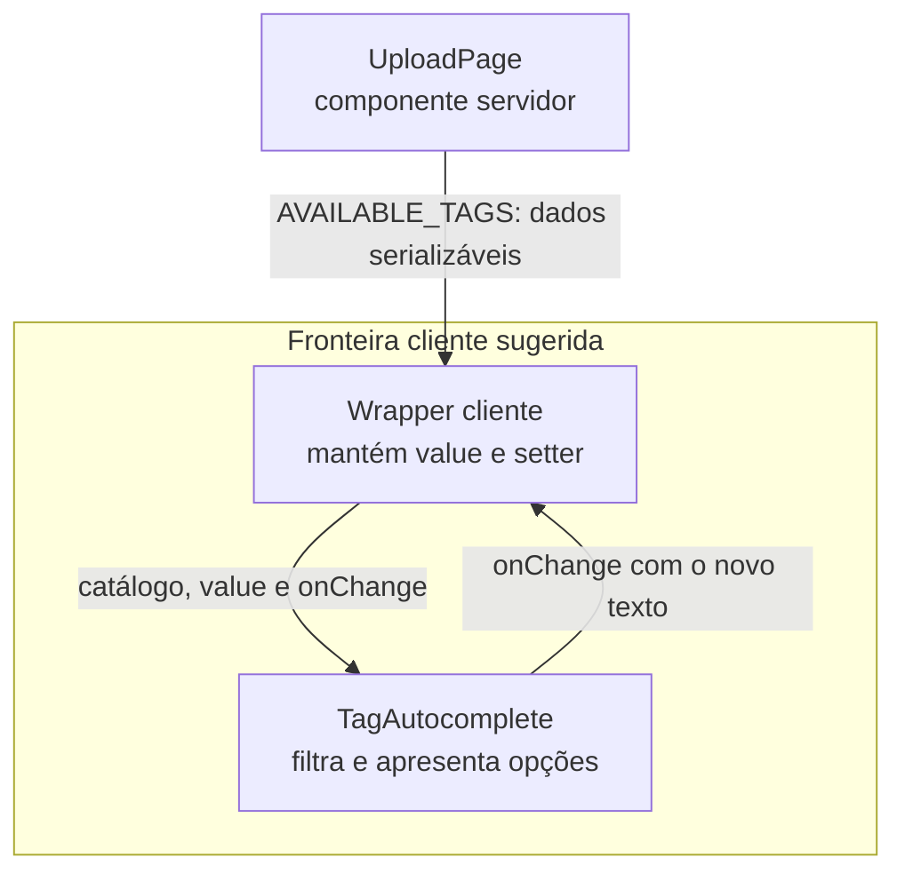

# Passo 3: Crie as sugestões no campo de tags

**O que vamos praticar:** fornecer código, regras e exemplos ao Copilot, aprovar um plano e só então autorizar a implementação.

**O que você vai construir:** em `/upload`, digitar `portrait, wi` deve mostrar `wildlife`; clicar nessa opção deve deixar `portrait, wildlife` no campo e fechar a lista. A seleção por teclado fica para o passo 4.

Continue na branch `improve-upload`. A entrega é o componente `TagAutocomplete.tsx` integrado à página Upload, não um documento de planejamento.

| Neste passo | Referência rápida |
| --- | --- |
| Tempo e sequência | 12 minutos · Plan → revisão humana → Agent |
| Entrada de referência | `portrait, wi` |
| Saída após clicar em `wildlife` | `portrait, wildlife`, com a lista fechada |
| Verificação | Quatro casos de filtro, clique, duplicatas e integração |
| Próxima fatia | Navegação por teclado, no passo 4 |

## Teoria: contexto é um conjunto de decisões sustentadas por fontes

Um pedido detalhado ainda pode produzir uma solução inadequada se descrever o comportamento sem mostrar a arquitetura existente. Por outro lado, anexar o repositório inteiro não resolve requisitos ambíguos. **Engenharia de contexto** combina regras duráveis, estado atual, objetivo e evidências, deixando claro o papel de cada fonte.

Neste caso, o placeholder contém `outdoor`, mas um placeholder não define o catálogo. O código mostra o que existe; esta lição define o que queremos; os testes fornecem exemplos executáveis. Se encontrar uma divergência, investigue-a — não peça ao agente para mudar o teste até ficar verde.

| Fonte | Decisão que sustenta | O que não comprova |
| --- | --- | --- |
| `.github/copilot-instructions.md` | Limites da mudança e convenções do projeto | Que a implementação já obedece às regras |
| `src/app/upload/page.tsx` e `src/lib/mock-tag-data.ts` | Ponto de integração e origem das sugestões | Como tratar todas as interações novas |
| `src/app/globals.css` | Classes e foco visual a preservar | Acessibilidade completa |
| `.github/steps/3-step.md` e `tests/solution/tag-autocomplete.test.tsx` | Comportamentos esperados e exemplos de aceite | Ausência de qualquer outro defeito |

Use `#` ou **Add Context** para fontes conhecidas. Para uma lacuna, peça busca direcionada; `#codebase`, se disponível, recupera trechos relevantes, **não anexa o projeto inteiro**. Acrescente fontes para resolver uma dúvida concreta, não para maximizar o volume de texto. Em uma nova sessão, transfira objetivo, plano aprovado, fontes e critérios — não todo o histórico de tentativas.

### Do pedido de produto aos critérios

Antes de discutir hooks, traduza a intenção em exemplos. Essa é uma aplicação de **step-back prompting**: voltar ao objetivo e às restrições antes de escolher a implementação. Peça decisões e justificativas verificáveis, não raciocínio privado.

```text
Texto digitado:       portrait, wi
Parte a preservar:   portrait,
Token de busca:                wi
Opção escolhida:               wildlife
Valor final:         portrait, wildlife
```

O recorte mostra a regra de produto: completar **o último token**, sem substituir o que veio antes. Ele não prescreve o algoritmo de implementação.

| Intenção | Exemplo de aceite | Erro que isso evita |
| --- | --- | --- |
| Ajudar no termo que estou escrevendo | `w` oferece `wedding` e `wildlife`; `portrait, wi` oferece `wildlife` | Filtrar pelo conteúdo inteiro do campo |
| Não perder o que já preenchi | Clicar em `wildlife` produz `portrait, wildlife` e fecha a lista | Substituir todas as tags pela selecionada |
| Manter termos consistentes | Comparar prefixos sem diferenciar caixa e ignorar espaços ao redor do token | Não reconhecer ` WI` |
| Evitar repetição | `wedding, wed` não sugere `wedding` novamente | Duplicar tags já escolhidas |
| Não abrir uma lista sem intenção de busca | Campo inicial, token vazio ou sem resultados não exibem opções | Abrir todo o catálogo ao receber foco |

**Contrato de integração, não solução pronta:** crie `src/components/upload/TagAutocomplete.tsx`, exportando `TagAutocomplete` por nome com estas props:

```ts
type TagAutocompleteProps = {
  availableTags: readonly string[];
  label: string;
  value: string;
  onChange: (value: string) => void;
};
```

O nome do tipo é ilustrativo; o nome do componente exportado e as quatro props fazem parte do contrato. `readonly` indica que o componente consome o catálogo, sem modificá-lo.

O Upload deve fornecer `AVAILABLE_TAGS` e preservar `name="tags"`, a label e o layout. Use os papéis `combobox`, `listbox` e `option`, com `aria-expanded` e `aria-controls` coerentes. O teclado será refinado no próximo passo.

### Onde deve ficar o estado?

No App Router, estado e eventos exigem um componente cliente. Isso não obriga a transformar toda a página em cliente: um wrapper pequeno pode manter `value`, passar `onChange` e renderizar o autocomplete, enquanto a página continua servidor. Funções comuns de callback não atravessam essa fronteira; mantenha o setter no lado cliente.

O valor é **controlado** porque o componente recebe o texto e notifica mudanças ao dono do estado. Já as sugestões podem ser derivadas desse valor e do catálogo. Duplicar ambos em estados independentes exige sincronização e abre espaço para uma lista desatualizada. O plano deve explicar essa divisão, não apenas listar arquivos.



**Leia o diagrama:** o catálogo cruza a fronteira como dados; o callback circula **dentro** da área cliente. O wrapper é uma opção de arquitetura, não um artefato obrigatório.

| Informação | Papel | Pergunta para revisar o plano |
| --- | --- | --- |
| Texto completo do campo | Valor controlado | Quem é o único dono desse valor? |
| Sugestões do token atual | Dados derivados | A lista acompanha texto e catálogo sem cópias desatualizadas? |
| Lista aberta ou fechada | Estado de interação | Como fechar após selecionar, mesmo que o texto ainda encontre resultados? |

## Atividade: decida a arquitetura antes de delegar (12 minutos)

1. Em Plan, anexe as fontes da tabela, incluindo esta lição. As instructions já são regras compartilhadas; confira seu conteúdo em vez de recriá-las. Use um modelo disponível adequado a uma tarefa com restrições interligadas; não é necessário comparar execuções.
1. Peça um plano, sem autorizar edições:

   ```text
   Planeje a entrega descrita nesta lição com base nas fontes anexadas.
   Antes dos arquivos, explique como cada exemplo de aceite se traduz
   em uma regra. Distinga valor controlado, dados derivados e estado de UI.
   Compare colocar estado na página com usar um wrapper cliente pequeno:
   recomende a menor fronteira cliente adequada ao código atual.
   Indique fontes, arquivos afetados, riscos e verificações de filtro,
   clique e integração. Separe o refinamento de teclado do próximo passo.
   Não implemente ainda; sinalize qualquer informação que esteja faltando.
   ```

1. **Faça a revisão do plano.** Localize as respostas a estas três decisões:
   - **Fonte de verdade:** usa o catálogo recebido ou cria uma lista hardcoded?
   - **Estado:** quem mantém o texto, e como a seleção preserva os tokens anteriores?
   - **Fronteira:** o que realmente precisa de `"use client"` e por quê?

   "Vou criar o componente, integrar e testar" é um plano insuficiente: não explica as decisões. Já converter toda a página em cliente **não é automaticamente um bug**, mas precisa de justificativa; compare com a alternativa menor. Não aceite API, persistência ou uma nova biblioteca para este problema.

   **Exemplo de plano que você consegue conferir no código:**

   ```text
   UploadPage continua servidor e fornece AVAILABLE_TAGS.
     -> UploadTagsField, wrapper cliente, mantém value e onChange.
       -> TagAutocomplete recebe as props, filtra o último token
          e notifica o novo valor quando uma opção é clicada.
   ```

   `UploadTagsField` é um nome sugerido, não exigido pelo gate. O nome e as props obrigatórios de `TagAutocomplete` estão no contrato acima. O plano pode ser diferente, desde que explique a integração e preserve os comportamentos.
1. Se o plano atende à revisão, passe para Agent e envie:

   ```text
   Implemente o plano aprovado para filtro e seleção por clique.
   Preserve os demais campos do Upload e não altere tests/solution.
   Execute o recorte de testes do passo 3 e mostre os arquivos alterados.
   ```

   Não precisa salvar um documento de plano. Se abrir outra sessão, leve o plano e as fontes.
1. Revise o diff e execute os exemplos da tabela no preview `/upload`. Verifique também se os outros campos e a seleção de arquivos permaneceram intactos.

1. Execute o recorte de aceitação desta entrega:

   ```bash
   node scripts/validate-step.mjs 3
   npm run test:solution -- tests/solution/tag-autocomplete.test.tsx -t "filters|click|already selected|integrates"
   ```

   O seletor `-t` executa filtro, clique, exclusão de tags já escolhidas e integração. Ele não certifica o teclado; essa separação permite entregar uma fatia funcional sem exigir tudo de uma vez.
1. Publique os arquivos de implementação, incluindo um eventual wrapper:

   ```bash
   git add src/app/upload/page.tsx src/components/upload
   git commit -m "Add tag suggestions to upload"
   git push
   ```

## Resultado esperado

**Entrega:** `src/components/upload/TagAutocomplete.tsx`, a integração em `src/app/upload/page.tsx` e um eventual wrapper em `src/components/upload/`.

### Para passar neste passo

1. No preview, digite `portrait, wi`, clique em `wildlife` e confira `portrait, wildlife` com a lista fechada.
1. O comando com `-t "filters|click|already selected|integrates"` deve aprovar os quatro casos selecionados. Os testes de teclado podem aparecer como ignorados nesse recorte; isso é esperado nesta etapa.
1. Faça commit e push dos arquivos da entrega. O **Passo 3** confere os artefatos, esse recorte, os testes do projeto, lint, build e os contratos intactos.
1. Aguarde **Passo 3 aprovado** na issue e a lição 4.

Ter somente o componente, sem conectá-lo ao Upload, falha no teste de integração. Ter somente um plano no Chat também não passa. O plano e os anexos são os meios; o comportamento na tela é a entrega.

<details>
<summary>Está com problemas? 🤷</summary><br/>

- **O teste não encontra `TagAutocomplete`:** exporte o componente por nome em `src/components/upload/TagAutocomplete.tsx`, com as props do contrato: `availableTags`, `label`, `value` e `onChange`.
- **O componente passa, mas o Upload falha:** um wrapper cliente pequeno é válido. Mantenha `name="tags"` e uma label acessível, sem labels aninhadas.
- **Vírgulas ou duplicatas falham:** filtre apenas o último token e compare as tags anteriores ignorando caixa e espaços.
- **O clique não seleciona:** o blur pode estar fechando a lista antes da seleção. Investigue a ordem dos eventos de foco.
- **O Copilot alterou arquivos demais:** rejeite apenas a proposta indesejada e reformule com os arquivos permitidos e os critérios de aceite.
- **O build local falha com `Operation not permitted` do Turbopack:** em ambiente restrito, confirme a compilação com `npm run build -- --webpack`, sem alterar a configuração. O Actions executa o build padrão.

Não edite o teste para contornar a falha.

</details>
