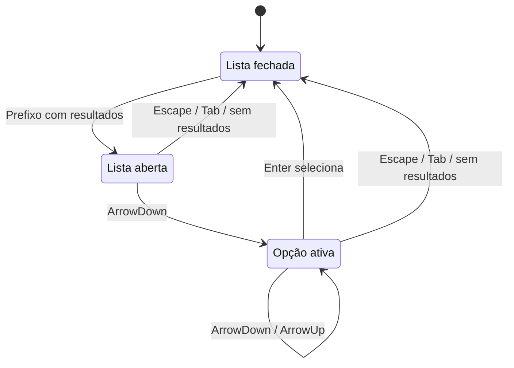

# Passo 4: Faça a seleção funcionar pelo teclado

**O que vamos praticar:** usar a saída de um teste como contexto para pedir uma correção localizada, em vez de enviar apenas "não funciona".

**O que você vai construir:** digitar `portrait, wi`, pressionar `ArrowDown` e `Enter` deve selecionar `wildlife` sem enviar o formulário. Escape fecha a lista; Tab permite sair do campo. O clique do passo anterior deve continuar funcionando.

Continue na branch `improve-upload`.

| Neste passo | Referência rápida |
| --- | --- |
| Tempo | 10 minutos |
| Ponto de partida | Filtro e clique do passo 3 funcionando |
| Nova entrega | Navegação por teclado com foco e ARIA coerentes |
| Verificação | `npm run test:solution`, sem o recorte `-t` |

## Teoria: modele transições e procure a causa da falha

**Foco no input** e **opção ativa na lista** são coisas diferentes. O foco permanece no campo para permitir continuar digitando; `aria-activedescendant` informa qual opção está ativa. Essa opção precisa existir no DOM e seu `aria-selected` deve corresponder à navegação. Pintar uma linha ou acrescentar atributos sem sincronizá-los não resolve a interação.



O diagrama resume os cenários principais, não impõe uma biblioteca ou todos os detalhes da navegação. **Fechar a lista não significa sempre a mesma coisa:** Enter aceita uma opção; Escape preserva o texto; Tab permite sair do campo.

Pense no componente como estados e transições, mesmo sem implementar uma biblioteca de máquina de estados:

| Situação | Evento | Resultado que deve permanecer coerente |
| --- | --- | --- |
| Campo vazio, lista fechada | Digitar um prefixo com resultados | Lista abre e `aria-expanded` acompanha |
| Lista aberta | ArrowDown/ArrowUp | Opção ativa muda; foco continua no input |
| Opção ativa | Enter | Seleciona, preserva tags anteriores, fecha e não submete |
| Lista aberta | Escape | Fecha sem apagar o texto |
| Lista aberta | Tab | Fecha e permite que o foco siga normalmente |
| Opção ativa | Editar o prefixo | A opção ativa não pode apontar para um item que desapareceu |

**Por que não basta derivar a abertura de "há resultados"?** 
R: Depois de Escape, o texto ainda encontra sugestões, mas a pessoa pediu para fechar. O estado de abertura representa uma intenção de interação que a lista filtrada, sozinha, não expressa.

**Por que Enter e Tab merecem tratamentos diferentes?** 
R: Dentro de um formulário, Enter pode acionar submissão; ao selecionar uma sugestão, esse efeito precisa ser evitado. Já impedir o comportamento padrão de Tab pode prender a pessoa no campo. Não bloqueie todas as teclas para resolver uma delas.

### O que a interface anuncia

| Elemento ou atributo | O que representa | Como conferir |
| --- | --- | --- |
| `role="combobox"` | Campo editável com sugestões | O input tem nome acessível e recebe foco |
| `aria-expanded` | Abertura da lista | É `true` quando a lista está aberta e `false` quando fecha |
| `aria-controls` | Ligação entre campo e lista | Com a lista aberta, aponta para seu `id` real |
| `aria-activedescendant` | Opção ativa durante a navegação | Aponta para uma opção existente; não fica apontando para um item removido |
| `role="option"` e `aria-selected` | Opção e indicação de atividade | A opção anunciada corresponde à que está visualmente ativa |

> [!IMPORTANT]
> <kbd>↓</kbd> e <kbd>↑</kbd> mudam a opção ativa, não o foco real. <kbd>Enter</kbd> aceita a opção. <kbd>Tab</kbd> segue a ordem natural de foco. Cor e destaque visual, sozinhos, não comunicam essas transições a tecnologias assistivas.

### Um erro é evidência; a causa ainda é uma hipótese

Se um teste informa "esperava foco no input", isso demonstra uma divergência observada, não explica automaticamente a causa. Pode haver mudança de foco para a opção, renderização que recria o campo ou outra transição indevida. Peça ao Copilot para relacionar a sequência de ações ao código antes de alterar.

O ciclo é **reproduzir → formular uma hipótese → localizar a causa → corrigir → repetir a verificação**. Forneça a saída relevante, o componente atual e o resultado esperado. Não acumule logs antigos nem troque de modelo antes de conferir as informações disponíveis. Uma capacidade maior pode ajudar em interações difíceis; não substitui uma reprodução.

## Atividade: complete e diagnostique o fluxo (10 minutos)

1. Execute o contrato completo. Leia a primeira falha relevante, não apenas o total de testes:

   ```bash
   npm run test:solution
   ```

1. No preview, reproduza a sequência correspondente. **Diferencie falta de funcionalidade de regressão:** uma tecla ainda não implementada exige completar o plano; um clique que deixou de funcionar exige investigar uma interação já entregue.
1. Anexe `.github/steps/4-step.md`, o componente, um eventual wrapper e `tests/solution/tag-autocomplete.test.tsx`. Use `#` ou **Add Context** para incluir a saída relevante do terminal, ou cole somente o trecho necessário, sem dados sensíveis. Adapte este pedido ao que realmente observou:

   ```text
   Complete ArrowDown/ArrowUp, Enter, Escape e Tab no autocomplete.
   Digitar portrait, wi e pressionar ArrowDown e Enter deve produzir
   portrait, wildlife sem submeter o formulário. Escape fecha sem apagar
   o texto; Tab fecha e deixa o foco sair. Mantenha o foco no input durante
   a navegação e uma referência ARIA válida para a opção ativa.
   Preserve filtro e clique. Use o erro anexado, quando houver, como evidência.
   Relacione a falha ao estado/evento responsável antes de editar.
   Faça a menor correção coerente com o plano, preserve o contrato público
   e execute novamente a verificação. Não altere tests/solution.
   ```

   **Exemplo de uso do erro:** se o teste de Enter esperava zero submissões e registrou uma, anexe essa saída e acrescente: "A seleção atualizou o campo, mas também submeteu o formulário; investigue o tratamento de Enter". Esse é um exemplo, não uma falha que você precisa provocar.

   Se tudo já estiver verde, diga isso ao Copilot e peça uma inspeção das transições, sem exigir mudanças. Não invente uma falha para completar o exercício.
1. **Julgue a correção proposta.** Ela trata a causa ou apenas esconde o sintoma? Por exemplo, remover `aria-activedescendant` evita um ID inválido, mas também deixa de anunciar a opção durante a navegação. A solução precisa manter a referência válida quando houver opção ativa, não eliminar o recurso.
1. Confira no preview:

   | Ação | Resultado esperado |
   | --- | --- |
   | `portrait, wi`, `ArrowDown`, `Enter` | `portrait, wildlife`, sem enviar o formulário |
   | `w`, duas vezes `ArrowDown`, depois `ArrowUp` | Ativa `wildlife` e volta para `wedding`, mantendo foco no campo |
   | `Escape` | Lista fecha sem alterar o texto |
   | `Tab` | Foco sai do campo e a lista fecha |
   | Ativar uma opção e depois apagar o texto | Não sobra lista nem referência ativa para uma opção removida |

   Abra novamente a lista entre cenários. Confira o foco visível e, nas ferramentas do navegador, se `aria-activedescendant` aponta para uma opção existente durante a navegação. O último cenário explora uma transição além do contrato mínimo e pode virar um teste seu no passo 5.

1. Execute novamente o contrato inteiro para detectar regressões na entrega anterior:

   ```bash
   node scripts/validate-step.mjs 4
   npm run test:solution
   ```

1. Se houve alteração, publique-a. Se a entrega já estava completa e os checks passaram, use **Actions > Passo 4 > Run workflow**, selecionando `improve-upload`; não faça commit artificial.

   ```bash
   git add src/app/upload/page.tsx src/components/upload
   git commit -m "Support accessible tag keyboard navigation"
   git push
   ```

## Resultado esperado

**Entrega:** o autocomplete atualizado com seleção por teclado, Escape, Tab e indicação acessível da opção ativa. Não há um novo componente obrigatório.

### Para passar neste passo

1. `npm run test:solution` deve terminar sem falhas, incluindo catálogo, filtro, clique, integração, teclado, foco e ARIA.
1. Publique a correção ou, se ela já estava pronta, execute **Actions > Passo 4 > Run workflow** na branch `improve-upload`.
1. O workflow também exige testes do projeto, lint, build e contratos preservados. Aguarde **Passo 4 aprovado** e a lição 5 na issue.

Passar somente o recorte do passo 3 não basta. Confira a execução real do contrato completo; a frase "os testes passaram" no Chat não substitui comando e saída. Essa execução usa uma ferramenta, mas não exige MCP nem comprova acessibilidade completa.

<details>
<summary>Está com problemas? 🤷</summary><br/>

- **O check falhou:** anexe a mensagem do teste ao pedido e solicite a menor correção necessária. Não remova asserções nem altere os contratos protegidos.
- **Teclado ou ARIA falha:** mantenha o foco no input, use IDs reais para a opção ativa e sincronize o estado anunciado. Enter deve selecionar sem enviar o formulário.
- **O teclado já funcionava desde o passo 3:** não crie mudanças artificiais. Use **Actions > Passo 4 > Run workflow** na branch `improve-upload`.

</details>
