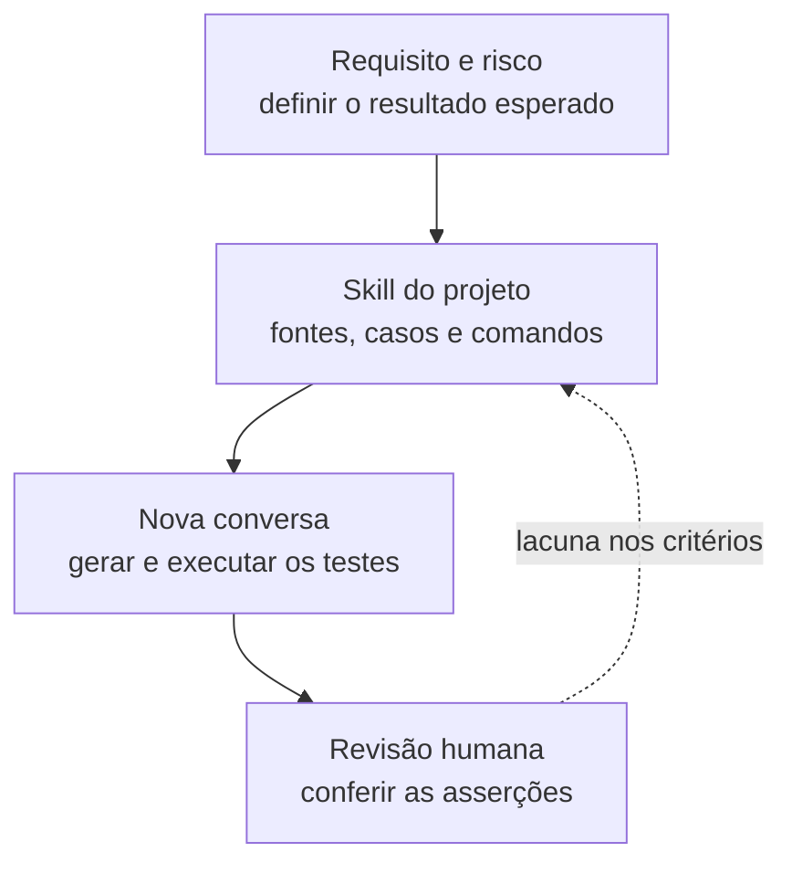

# Passo 5: Crie uma skill e dois testes de regressão

**O que vamos praticar:** transformar uma tarefa de testes em uma skill do projeto que especifica as ações e os resultados corretos, sem depender de uma conversa anterior.

**O que você vai entregar:** `.github/skills/test-tags/SKILL.md` e `tests/tag-autocomplete.test.tsx`, com pelo menos dois testes executados e aprovados. O roteiro abaixo protege busca em maiúsculas e desaparecimento das sugestões quando não há correspondência.

Continue na branch `improve-upload`.

| Neste passo | Referência rápida |
| --- | --- |
| Tempo | 8 minutos |
| Procedimento reutilizável | `.github/skills/test-tags/SKILL.md` |
| Código de teste | `tests/tag-autocomplete.test.tsx` |
| Mínimo automatizado | Dois testes próprios executados e aprovados |
| Responsabilidade humana | Conferir se as ações e asserções realmente protegem o requisito |

## Teoria: quem gera o teste não deve inventar o resultado correto

Pedir "teste este componente" pode produzir testes que apenas confirmam o código atual, inclusive seus defeitos. Antes da geração, estabeleça o **oráculo do teste**: o resultado esperado a partir do requisito, independentemente da implementação. O componente mostra como a solução foi escrita; não é a única fonte do que ela deveria fazer.

Um bom caso conecta **risco → ação → resultado observável**. Por exemplo: "o índice ativo fica desatualizado quando a lista muda" é um risco; "digitar, navegar e apagar o campo" é a ação; "lista fechada e nenhuma opção inexistente anunciada" é o resultado.

| Teste fraco para esta entrega | O que ainda poderia estar errado | Verificação útil |
| --- | --- | --- |
| O componente renderiza | Nenhuma sugestão aparece ao digitar | Consultar as opções após uma interação |
| `onChange` foi chamado | O valor apagou as tags anteriores | Conferir o valor final em um wrapper controlado |
| Um snapshot não mudou | A sequência de teclado nunca foi exercitada | Simular eventos com `userEvent` e conferir foco/estado |

O wrapper mantém `value` e o atualiza por `onChange`, como a integração real. Uma lista local de tags torna o cenário previsível: um teste sobre interação não deveria quebrar apenas porque o catálogo de produção ganhou um termo.

### Como ler um teste de comportamento

Este é um **recorte de interação e asserções**, não um arquivo de teste completo. Ele pressupõe um wrapper controlado renderizado, `user` criado com `userEvent.setup()` e `input` localizado por papel e nome acessível:

```tsx
await user.type(input, "portrait, WI");
await user.click(screen.getByRole("option", { name: "wildlife" }));

expect(input).toHaveValue("portrait, wildlife");
expect(screen.queryByRole("listbox")).not.toBeInTheDocument();
```

| Trecho | O que protege |
| --- | --- |
| `await user.type(...)` | A sequência inclui digitação realista, com maiúsculas e uma tag anterior |
| `getByRole("option", ...)` | A opção precisa existir para ser selecionada |
| `toHaveValue(...)` | O resultado não pode apagar `portrait` |
| `queryByRole(...)` + ausência | A lista deve fechar após a escolha |

Use `getByRole` quando espera encontrar o elemento; `queryByRole` permite verificar que ele não está presente. A asserção de ausência só é útil quando a sequência anterior também foi exercitada.

### Reutilize a tarefa, não o histórico da conversa

Nos cursos anteriores, você criou personalizações. Aqui, escolha o que precisa ficar explícito para outra sessão repetir a tarefa:

| Recurso | O que deve carregar | O que não substitui |
| --- | --- | --- |
| **Instructions** | Convenções duráveis, como não adicionar outro runner | Casos específicos desta tarefa |
| **Skill** | Quando usar, fontes, casos, ações e comandos de verificação em `SKILL.md` | Revisão dos testes gerados |
| **Agente e modelo** | Quem executa a tarefa e qual modelo a processa | A definição do resultado correto |

A skill pode incluir recursos de apoio, mas um arquivo basta para esta atividade.



**Leia o fluxo:** escreva o resultado esperado antes de gerar código; depois confira execução **e** qualidade das asserções. Se faltar uma informação reutilizável, corrija a skill, não dependa da conversa anterior.

A pasta `test-tags` e o campo `name: test-tags` identificam a skill, invocada por `/test-tags`. A `description` explica o que ela faz e quando usá-la. Neste exercício, `disable-model-invocation: true` reserva a execução para uma chamada manual, evitando que a geração de testes seja iniciada automaticamente em outra tarefa.

O comando carrega as instruções na sessão atual: não escolhe um modelo, não é um comando de shell e não autoriza ferramentas automaticamente. Não há `agent: agent` no cabeçalho desta skill. Usaremos uma sessão Copilot com capacidade de editar e executar testes, sem depender do Local legado.

Veja o [formato e a descoberta de skills no VS Code](https://code.visualstudio.com/docs/agent-customization/agent-skills). Descobrir a skill, invocá-la e conferir os testes gerados são verificações diferentes.

## Atividade: projete dois testes antes de gerá-los (8 minutos)

1. Abra `tests/solution/tag-autocomplete.test.tsx` para não copiar os casos fornecidos. Para esta atividade, use uma lista local com `portrait`, `wedding` e `wildlife` e implemente estes dois cenários:

   | Risco | Sequência sugerida | Resultado a proteger |
   | --- | --- | --- |
   | Normalização só funciona no caso simples | Digitar `portrait, WI` e selecionar `wildlife` | Sugestão encontrada; valor `portrait, wildlife` |
   | Lista antiga sobrevive a uma busca sem resultados | Digitar `w` e depois `zzz` | Sem sugestões da busca anterior, preservando o texto `wzzz` |

   O primeiro detecta busca sensível à caixa ou perda das tags anteriores. O segundo detecta uma lista que não acompanha o texto atual. Você pode escolher outros dois casos relevantes; o gate exige a execução de pelo menos dois testes próprios, não nomes específicos.
1. No Explorer, crie a pasta `.github/skills/test-tags` e o arquivo `SKILL.md` dentro dela, com o conteúdo abaixo. Use o nome do arquivo em maiúsculas. Os resultados esperados já estão escritos: revise-os antes de delegar a geração dos testes.

   ```markdown
   ---
   name: test-tags
   description: Gerar e executar testes de regressão do autocomplete de tags. Use quando precisar proteger interações do campo de tags da página Upload.
   disable-model-invocation: true
   ---
   # Testar o autocomplete de tags

   Execute os comandos a partir da raiz do repositório.
   Examine [TagAutocomplete](../../../src/components/upload/TagAutocomplete.tsx)
   e o [setup de testes](../../../tests/setup.ts).

   Use os casos descritos abaixo como requisitos, não deduza o resultado
   correto apenas da implementação atual. Com Vitest, React Testing Library
   e userEvent, crie testes em tests/tag-autocomplete.test.tsx.
   Use uma lista local de tags e um wrapper controlado. Consulte elementos
   por papel e nome acessível quando aplicável; teste resultados observáveis,
   sem depender dos nomes de hooks ou funções privadas.

   Não copie nem altere tests/solution e não adicione dependências.
   Execute npm test -- --run tests/tag-autocomplete.test.tsx.
   Se falhar, diferencie erro do teste de defeito no componente.
   Não enfraqueça a asserção para reproduzir o comportamento defeituoso.

   ## Casos e resultados esperados
   Use a lista local ["portrait", "wedding", "wildlife"].

   1. Digite "portrait, WI". A opção "wildlife" deve aparecer.
      Clique nela e confira valor "portrait, wildlife" e lista fechada.
   2. Digite "w" e confira que há sugestões. Continue digitando "zzz".
      Confira valor "wzzz", ausência de opções e lista fechada.
   ```

1. Salve o arquivo e abra uma **nova conversa Copilot** no mesmo workspace, com capacidade de editar e executar testes. Digite `/`, selecione a skill `/test-tags` e envie. Confira na atividade do Chat o carregamento de `.github/skills/test-tags/SKILL.md` e a execução dos testes. A nova conversa verifica se fontes e critérios estão na skill, não só no histórico anterior. Se a skill não aparecer, use a ajuda ao final desta lição antes de continuar.
1. **Revise cada asserção.** No primeiro caso, procure a digitação, o clique e a conferência de `portrait, wildlife`; no segundo, confira que o teste mostra sugestões antes de eliminá-las com `zzz`. As ações de `userEvent` devem ser aguardadas. Se o teste só verifica que o input existe, ele não cobre o cenário. Se revelar um defeito real, corrija o componente sem adaptar o resultado esperado ao bug.
1. Execute:

   ```bash
   node scripts/validate-step.mjs 5
   npm test -- --run tests/tag-autocomplete.test.tsx
   npm run test:learner
   npm run test:solution
   ```

6. Publique a skill, os testes e qualquer correção necessária:

   ```bash
   git add .github/skills/test-tags tests/tag-autocomplete.test.tsx
   git add src/app/upload/page.tsx src/components/upload
   git commit -m "Add reusable tag regression tests"
   git push
   ```

## Resultado esperado

**Entrega:** a skill versionada e um arquivo com pelo menos dois casos `it`/`test` próprios, sem `skip` ou `todo`. Não basta escrever as instruções ou os testes no Chat.

### Para passar neste passo

1. `node scripts/validate-step.mjs 5` deve aceitar os arquivos e os campos da skill: `name: test-tags`, `description` preenchida e referências ao componente, Vitest e arquivo de testes.
1. `npm run test:learner` deve informar **2 testes do aluno executados e aprovados**, ou mais. `npm run test:solution` deve continuar sem falhas.
1. Faça commit e push da skill, dos testes e de eventual correção. O **Passo 5** também executa os testes do projeto, lint, build e confere os contratos.
1. Aguarde **Passo 5 aprovado** e a lição 6 na issue.

Aparecer `/test-tags` no menu não basta para passar. A automação confere o arquivo e conta testes aprovados, mas não observa a sessão do editor nem **avalia semanticamente as asserções**. Você deve conferir o carregamento da skill e os dois cenários descritos acima. Mantenha a skill na branch: o passo 6 volta a validá-la.

<details>
<summary>Está com problemas? 🤷</summary><br/>

- **Os testes não executam:** siga `tests/setup.ts`, use `@/` para imports e não instale outro runner.
- **O gate não reconhece seus testes:** entregue pelo menos dois testes aprovados em `tests/tag-autocomplete.test.tsx`, sem `skip` ou `todo`. Confira com `npm run test:learner`.
- **`/test-tags` não aparece:** confira `.github/skills/test-tags/SKILL.md`, `name: test-tags` e se o arquivo foi salvo. Abra **Chat: Open Customizations > Skills** na sessão Copilot e procure a skill do workspace. Não use `user-invocable: false`, pois isso a esconde do menu. Inicie uma nova conversa após corrigir. Se uma política bloquear skills, informe ao facilitador; anexar o texto não comprova descoberta ou invocação da skill.
- **Uma fonte não é encontrada:** os links do exemplo partem de `SKILL.md`; são três níveis até a raiz (`../../../`). Já os comandos devem executar na raiz do repositório.
- **A skill depende de algo dito antes:** coloque o caso, o resultado e a referência que faltam no próprio `SKILL.md`; não copie o histórico inteiro.
- **Um contrato foi alterado sem querer:** confira com `git diff origin/main -- tests/solution/` e desfaça apenas a alteração indevida.

</details>
