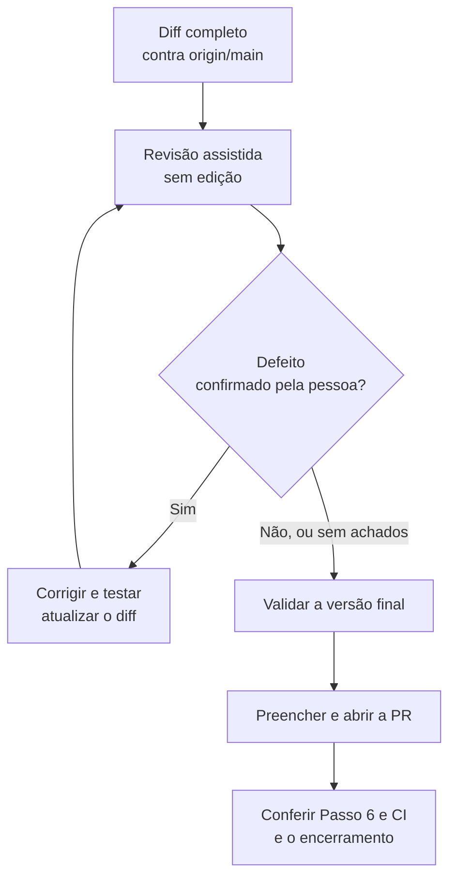

# Passo 6: Abra uma PR com as verificações aprovadas

**O que vamos praticar:** usar a revisão do Copilot para encontrar problemas no diff e conferir cada achado antes de aceitar uma alteração.

**O que você vai entregar:** uma PR da branch `improve-upload` para `main`, no seu próprio repositório, com descrição preenchida e os workflows **Passo 6** e **CI** aprovados. Não é necessário fazer merge.

| Neste passo | Referência rápida |
| --- | --- |
| Tempo | 8 minutos |
| Comparação da revisão | Entrega completa contra `origin/main`, não só alterações locais |
| Origem → destino da PR | `improve-upload` → `main`, no mesmo repositório |
| Evidência final | Descrição preenchida, checks no commit final e `finish_exercise` concluído |
| Não é exigido | Merge, MCP, Space ou coding agent |

## Teoria: revisão assistida não é aprovação delegada

**Human-in-the-Loop** não é clicar em aprovar no final. Ao longo do exercício, você delimitou o problema, escolheu contexto, aprovou uma fronteira de estado e definiu resultados de testes. Na revisão, volta a exercer essa responsabilidade: aceitar, investigar ou rejeitar cada achado do Copilot.

Um achado útil aponta **local + condição de reprodução + consequência**. "Pode haver problema de acessibilidade" é genérico. "Após filtrar novamente, o ID ativo ainda aponta para uma opção removida" permite procurar o trecho responsável e reproduzir. Mesmo um achado específico pode estar errado; confira antes de editar.

Da mesma forma, CI verde tem alcance limitado. Build verifica compilação, não intenção de produto. Os testes cobrem os cenários que executam, não todas as sequências possíveis. Revisão assistida procura problemas, mas não certifica ausência deles. Combine evidências sem afirmar mais do que foi verificado.



**Leia o fluxo:** o Copilot propõe achados; a pessoa revisora decide com base no código e na reprodução. Uma correção muda a versão a validar, por isso resultados antigos não bastam.

| Evidência | Sustenta | Não permite afirmar sozinha |
| --- | --- | --- |
| Diff contra `origin/main` | Quais arquivos e comportamentos foram alterados | Que a experiência funciona |
| Testes e respectivos resultados | Quais cenários foram executados com sucesso | Ausência de defeitos fora desses cenários |
| Preview com clique e teclado | Comportamento observado nessas interações | Avaliação completa com tecnologias assistivas |
| Lint e build | Análise estática e compilação aprovadas | Correção da intenção de produto |

### Quando contexto e execução saem do workspace

Imagine que outra pessoa comentou na PR: "Escape funciona, mas a busca não reabre". O diff local não contém necessariamente esse comentário atual. O assistente precisa recebê-lo ou consultá-lo por uma integração autorizada. É aqui que os conceitos da apresentação se conectam ao mesmo trabalho:

| Necessidade | Mecanismo possível | Limite importante |
| --- | --- | --- |
| Executar os testes locais | Ferramenta de terminal | Não exige MCP |
| Consultar comentários atuais ou criar uma issue | GitHub CLI ou ferramenta GitHub MCP | A CLI não se torna MCP por ser chamada pelo agente |
| Reunir fontes para discussões da equipe | Copilot Space | Curadoria de contexto não implementa a feature |
| Delegar uma correção para execução em outro ambiente | Coding agent | Não herda automaticamente sua conversa; a PR resultante exige revisão |

**MCP** é um protocolo para conectar ferramentas e fontes ao assistente, não um modelo, participante ou sinônimo de RAG. Recuperar um comentário é leitura; publicar outro comentário ou uma issue é escrita. Antes de uma escrita, confira ferramenta, repositório, argumentos e autorização. Depois, verifique o artefato real: uma frase no Chat não comprova uma ação externa.

Esse raciocínio vale mesmo sem MCP: `gh pr create` também modifica um serviço externo. As permissões vêm da autenticação e das políticas, não de `#` ou do texto do pedido. A demonstração em `.github/steps/x-extension.md` aprofunda isso; **não configure MCP, Space ou coding agent para concluir**.

## Atividade: revise, justifique e entregue (8 minutos)

1. Na branch `improve-upload`, atualize a referência de comparação e confira a entrega completa, incluindo commits anteriores:

   ```bash
   git fetch origin
   git diff origin/main -- src tests .github/skills
   git diff --exit-code origin/main -- tests/solution/
   ```

   Confirme que preservou os contratos e não introduziu dependências desnecessárias, backend ou persistência. Um working tree limpo não significa uma PR sem alterações.
2. Em uma conversa de revisão, forneça a comparação contra `origin/main` e os arquivos relevantes. Use `#` ou **Add Context** se o contexto de alterações oferecer essa comparação; se mostrar apenas alterações não commitadas, anexe a saída do primeiro `git diff` acima.

   ```text
   Revise a entrega comparada com origin/main, sem editar.
   Procure regressões em preservação de tokens, filtro, clique, teclado,
   foco e referências ARIA; relacione os testes aos riscos cobertos.
   Para cada achado, indique local, sequência que expõe o problema e
   consequência. Diferencie defeito observado de hipótese a verificar.
   Não invente problemas para preencher uma lista e não aprove por mim.
   ```

3. **Decida o destino dos achados:** reproduza os plausíveis, corrija os confirmados e descarte os que contradizem o código ou o comportamento. Não é obrigatório encontrar defeitos. Se houver correção, reexecute os testes afetados e publique somente os arquivos envolvidos.
4. Confira as validações finais:

   ```bash
   npm test
   npm run test:solution
   npm run test:learner
   npm run lint
   npm run build
   ```

   Aproveite as execuções recentes quando correspondem exatamente ao código final; após uma correção, não use um resultado anterior como evidência da versão nova.
5. Abra uma PR de `improve-upload` para `main` usando o template:

   ```bash
   gh pr create --base main --head improve-upload --title "Improve upload tags" --body-file .github/pull_request_template.md
   ```

   O comando cria a PR com o texto-base. Abra a página da PR e edite a descrição, preservando os títulos e checkboxes do template:
   - **Objetivo:** descreva a experiência entregue, não apenas a lista de arquivos.
   - **Verificações:** marque somente o que executou; preencha a tabela com comandos e resultados, além das interações verificadas manualmente. Substitua `Não executado` apenas por um resultado que você conferiu.
   - **Decisões e limitações:** explique uma escolha real, como a fronteira cliente, e o que não foi comprovado. Não afirme acessibilidade completa se verificou apenas teclado e os contratos.

   Por exemplo, se isso corresponde à sua implementação: "O Upload agora sugere tags pelo último termo digitado e preserva os anteriores. Um wrapper cliente mantém o valor sem converter toda a página em cliente. Conferi clique, teclado, Escape e Tab; não fiz uma avaliação com leitor de tela". Complete as verificações com os seus resultados reais, não copie uma alegação de sucesso.
6. Aguarde **Passo 6** e **CI** ficarem verdes no commit final. Leia o resultado, não apenas a presença do check. O exercício não exige merge automático: a decisão continua sua.

## Resultado esperado

**Entrega:** a PR publicada, com o template preenchido e os commits finais da melhoria.

### Para passar neste passo

1. Confira na PR: base `main`, origem `improve-upload` e ambas no mesmo repositório. Uma PR de um fork não aciona a entrega prevista.
2. Em **Checks**, aguarde **Passo 6** e **CI** aprovados no commit final. São exigidos a skill `.github/skills/test-tags/SKILL.md` com os metadados do passo 5, contratos completos, testes próprios, testes do projeto, lint, build e preservação de `tests/solution/`.
3. Na issue, confira **Passo 6 aprovado** e a revisão final. Em Actions, confira também a conclusão do job `finish_exercise`.

Push sem PR não conclui esta etapa. Uma descrição dizendo "testado" também não substitui os checks. A qualidade da revisão e do texto continua sendo responsabilidade humana; o workflow não lê sua conversa.

<details>
<summary>Está com problemas? 🤷</summary><br/>

- **Um check falhou:** abra o log, corrija na mesma branch e publique novamente. Não crie outra PR nem modifique workflows ou contratos para contornar a falha.
- **A PR não encerrou o exercício:** a PR deve ser do mesmo repositório, de `improve-upload` para `main`. Se ela foi criada antes de o passo 6 ser habilitado, faça um novo push na branch ou reabra a PR.
- **A revisão final apareceu, mas o encerramento falhou:** abra o job `finish_exercise` em **Actions > Passo 6** e reexecute somente esse job. Não é necessário refazer a implementação.
- **Uma ferramenta MCP não aparece:** MCP não é requisito deste passo. Nunca forneça tokens no Chat.

</details>
