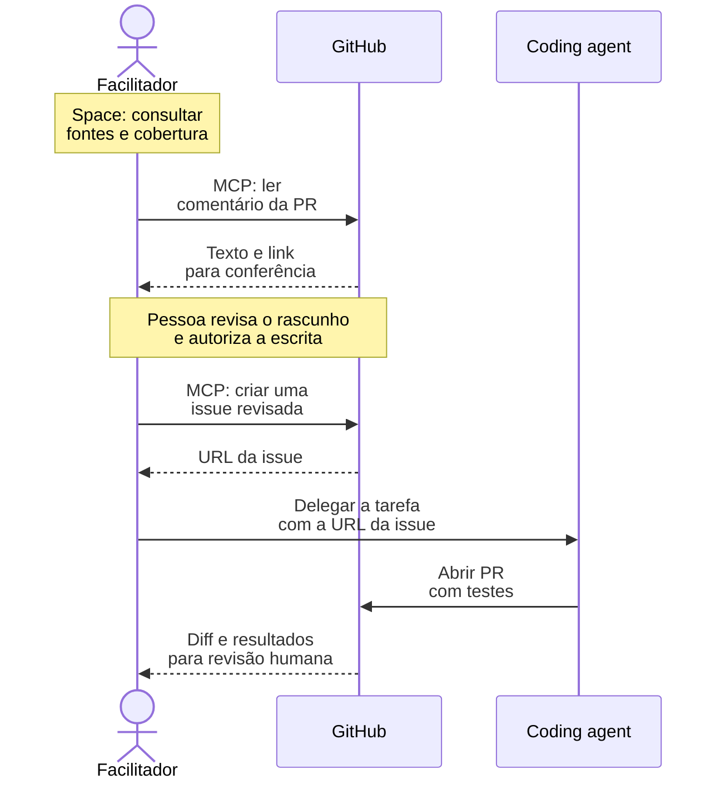

# Extensão opcional: de um comentário da PR a dois testes novos

**O que vamos explicar:** Space reúne fontes para responder sobre uma implementação; MCP permite consultar e modificar o GitHub por ferramentas autorizadas; coding agent executa uma tarefa em outro ambiente e produz mudanças para revisão.

**O que vamos fazer:** partir de um comentário sobre o autocomplete, criar uma issue com dois casos de teste e mostrar uma PR que os implementa.

> [!NOTE]
> **Isso é necessário para passar? Não.** É uma demonstração do facilitador durante a apresentação, não uma sétima etapa. Não exige mudanças ou configuração na conta do aluno e não participa da validação. Para concluir o hands-on, siga os critérios dos passos 1 a 6. Não acrescente tempo às duas horas do treinamento.

## Mapa da demonstração



**Leia o fluxo:** o Space ajuda a entender; o MCP lê e escreve com autorização; o agente implementa; a pessoa confere as evidências. A issue é a passagem de contexto entre ambientes, não o histórico inteiro do Chat.

## Cenário: o que acontece quando apagamos a busca?

O autocomplete já funciona com clique e teclado. Um comentário na PR pede:

> "Quero proteger este fluxo: digitar `w`, navegar até uma sugestão e apagar todo o campo. A lista deve fechar, sem uma opção ativa inexistente. Depois, digitar `wi` deve permitir selecionar `wildlife` normalmente."

Isso é um pedido de cobertura, **não a afirmação de que existe um bug**. Se a implementação já estiver correta, a entrega pode conter somente testes.

| Momento | Ação na tela | Resultado concreto |
| --- | --- | --- |
| Space | Consultar componente e testes selecionados | Resposta que aponta o que já existe e onde falta um teste |
| MCP: leitura | Buscar o comentário da PR | Retorno de ferramenta com texto e link conferidos no GitHub |
| MCP: escrita | Criar a issue revisada | Issue real com título, dois critérios e limites de alteração |
| Coding agent | Executar a issue em uma branch separada | PR com os dois testes, seus resultados e diff revisável |

## Prepare antes da apresentação

Use um repositório de demonstração autorizado, separado do template e dos repositórios dos alunos.

1. Deixe a solução dos seis passos disponível na `main` desse repositório, com testes, lint e build aprovados. Confira que os dois casos desta demonstração ainda não estão cobertos. Não remova testes de uma entrega real para fabricar uma lacuna.
2. Tenha uma PR real da implementação e publique nela o comentário do cenário como **comentário de conversa**, identificando-o como material da demonstração.
3. Configure e teste previamente o GitHub MCP no ambiente do facilitador, com acesso ao repositório e ferramentas de leitura de comentários e criação de issues. Confira também o acesso ao coding agent. Não faça instalação, autenticação ou compartilhamento de tokens durante a atividade dos alunos.
4. Prepare uma gravação ou uma PR concluída anteriormente, ainda separada da `main`, mostrando essa mesma tarefa. Assim, você pode mostrar o resultado sem esperar a execução ao vivo.

Nos pedidos abaixo, substitua os marcadores antes de enviar ao Chat:

| Marcador | Valor a usar | Conferência antes de executar |
| --- | --- | --- |
| `REPO_DEMO` | `proprietário/repositório` | É o repositório de demonstração autorizado, não o de um aluno |
| `PR_DEMO` | URL da PR da implementação | Contém o comentário do cenário |
| `LINK_DO_COMENTARIO` | Link direto do comentário lido | O texto retornado corresponde ao GitHub |
| `ISSUE_DEMO` | URL da issue criada após aprovação | Contém os dois casos, fontes e limites revisados |

São marcadores, não variáveis de terminal. Use apenas dados autorizados para a demonstração.

## 1. Space: localizar o comportamento e a cobertura

**Conceito em uma frase:** em vez de reenviar os mesmos arquivos a cada pergunta, você reúne as fontes relevantes em um espaço que pode voltar a consultar e compartilhar conforme as permissões.

### Faça na tela

1. Abra [Copilot Spaces](https://github.com/copilot/spaces), selecione **Create space** e dê o nome `Luma Gallery - tags`. Confira proprietário e acesso antes de compartilhar.
2. Em **Add sources**, selecione os arquivos do repositório de demonstração:
   - `src/components/upload/TagAutocomplete.tsx`;
   - `src/app/upload/page.tsx` e o wrapper cliente, se houver;
   - `src/lib/mock-tag-data.ts`;
   - `tests/tag-autocomplete.test.tsx`;
   - `tests/solution/tag-autocomplete.test.tsx`.
3. Adicione a URL `PR_DEMO` como fonte. No campo de **instructions** do Space, use:

   ```text
   Ajude a revisar o autocomplete de tags desta Luma Gallery.
   Cite os arquivos e testes que sustentam cada conclusão.
   Diferencie comportamento implementado de comportamento testado.
   Se uma fonte estiver ausente, diga qual falta; não invente cobertura.
   ```

4. Pergunte no Space:

   ```text
   Onde o autocomplete trata a limpeza do campo depois de navegar nas
   sugestões? Existe teste que digita w, ativa uma opção e limpa o campo?
   Existe teste que volta a digitar wi e seleciona wildlife depois disso?
   Aponte os trechos encontrados e os testes que faltam, sem gerar código.
   ```

### Confira o resultado

Abra uma referência do componente e uma dos testes. Um teste que apenas seleciona `wildlife` não cobre automaticamente "selecionar depois de limpar". A resposta deve reconhecer essa diferença ou apontar um teste que realmente execute a sequência.

**A demonstração funcionou quando:** você consegue mostrar as fontes que sustentam a resposta, não apenas uma explicação genérica de autocomplete. Nenhum arquivo foi editado nesta etapa.

> Fontes de código em Spaces acompanham a `main`, não as alterações locais ainda não publicadas. Por isso, a preparação pede a solução na `main` do repositório de demonstração. Veja [como criar e adicionar fontes a Spaces](https://docs.github.com/en/copilot/how-tos/copilot-on-github/customize-copilot/copilot-spaces/create-copilot-spaces).

## 2. MCP: ler o comentário e criar uma issue aprovada

**Conceito em uma frase:** o assistente chama uma ferramenta para acessar o estado real do GitHub; escrever "consulte a PR" no Chat, sozinho, não demonstra que o acesso aconteceu.

### Primeiro, somente leitura

1. No Chat do VS Code, mostre o GitHub MCP já configurado e a ferramenta de leitura disponível no seletor.
2. Substitua os marcadores e envie:

   ```text
   Use as ferramentas do GitHub MCP para ler os comentários de conversa
   de PR_DEMO em REPO_DEMO. Localize o pedido sobre limpar o campo de tags.
   Retorne o texto e o link do comentário. Não crie nem altere nada.
   Se a ferramenta estiver indisponível, informe isso; não simule a leitura
   e não substitua por GitHub CLI nesta demonstração.
   ```

3. Expanda a chamada de ferramenta: confira repositório, PR, operação de leitura e retorno. Abra o link no GitHub e compare o comentário.

**A leitura funcionou quando:** o comentário retornado corresponde ao comentário real e você viu a chamada MCP. O nome da ferramenta pode variar; uma resposta sem chamada ou uma execução de `gh` não comprovam uso de MCP.

### Depois, uma escrita com escopo fechado

4. Peça **somente o rascunho** de uma issue com o corpo abaixo. Inclua o link do comentário lido, substituindo `LINK_DO_COMENTARIO`:

   ```markdown
   Título: Testar limpeza e reinício das sugestões de tags

   Contexto: LINK_DO_COMENTARIO.
   O autocomplete já está implementado na main. Queremos proteger duas
   sequências ainda sem cobertura, não reescrever a funcionalidade.

   Fontes: src/components/upload/TagAutocomplete.tsx,
   tests/tag-autocomplete.test.tsx e tests/setup.ts.

   Adicione em tests/tag-autocomplete.test.tsx, sem remover testes existentes:
   1. "clears an active tag search": com uma lista local contendo wedding
      e wildlife, digite w, pressione ArrowDown e limpe o campo.
      Espere valor vazio, lista fechada, aria-expanded="false" e
      aria-activedescendant ausente ou vazio.
   2. "restarts tag suggestions after clearing": faça a mesma sequência,
      depois digite wi e pressione ArrowDown e Enter.
      Espere valor wildlife, lista fechada e foco no input.

   Use Vitest, React Testing Library, userEvent e wrapper controlado.
   Se um caso revelar bug, faça a menor correção no componente.
   Não altere tests/solution, workflows ou dependências. Não acrescente API.
   Execute os dois casos novos, a suíte existente, os contratos, lint e build.
   Abra uma PR para main com comandos, resultados e limitações. Não faça merge.
   ```

5. Confira título, critérios e repositório. Só então envie:

   ```text
   Autorizo criar uma única issue em REPO_DEMO com o título e o corpo
   que acabei de revisar. Use a ferramenta GitHub MCP de criação de issue.
   Não atribua agentes, não crie PR e não altere outros artefatos.
   Retorne a URL criada. Se já existir uma issue equivalente, mostre-a
   em vez de criar uma duplicata.
   ```

6. Revise os argumentos da chamada antes de aprová-la. Abra a URL retornada e confira o conteúdo. Essa URL passa a ser `ISSUE_DEMO`.

**A escrita funcionou quando:** há uma issue real no repositório autorizado com os dois casos descritos. O rascunho no Chat não é a entrega.

**O que explicar à turma:** ler comentários e criar uma issue são operações distintas, com efeitos e permissões diferentes. MCP é o protocolo de acesso, não quem decide que o conteúdo está correto. Nenhum `#`, participante ou modelo concede essa autorização.

## 3. Coding agent: produzir a PR dos dois testes

**Conceito em uma frase:** você entrega uma tarefa completa para execução em outro ambiente; não precisa acompanhar cada edição, mas precisa revisar a PR resultante.

### Faça na tela

1. Abra **Agents** no repositório de demonstração. Confira o repositório de trabalho e a base `main` — anexar uma URL como contexto não seleciona, por si só, onde o agente fará mudanças.
2. Inicie uma tarefa do Copilot com este pedido, substituindo os marcadores:

   ```text
   Em REPO_DEMO, implemente a tarefa de ISSUE_DEMO a partir de main.
   Leia a issue e as fontes indicadas antes de editar. Adicione os dois
   testes nomeados, preserve os testes existentes e corrija a implementação
   somente se um caso revelar defeito. Respeite os limites da issue.
   Abra uma PR para main com os resultados das verificações. Não faça merge.
   ```

3. Mostre a sessão iniciada. O agente não recebe automaticamente o histórico do seu Chat ou do Space: os requisitos e referências necessários estão na issue.
4. Sem esperar a execução, abra a PR preparada previamente ou a gravação. Avise explicitamente: **"Esta é uma execução anterior da mesma tarefa; não é o resultado da sessão que acabamos de iniciar."**
5. Em **Files changed**, localize os dois testes pelo nome. Confira as ações e asserções, não apenas o número de linhas. Se houver alteração no componente, relacione-a a uma falha que o teste revelou.
6. Nos logs dessa PR, mostre a execução dos casos novos:

   ```bash
   npm test -- --run tests/tag-autocomplete.test.tsx -t "clears an active tag search|restarts tag suggestions after clearing"
   ```

   Espere **dois testes executados e aprovados**; os testes fora desse recorte podem aparecer como ignorados. Confira também `npm test`, `npm run test:solution`, `npm run lint` e `npm run build` no mesmo commit.

**A entrega está demonstrada quando:** a PR contém os dois testes, os resultados correspondem ao código mostrado e os contratos não foram alterados. Uma PR aberta sem esses resultados demonstra início de trabalho, não conclusão. O merge permanece uma decisão humana.

Se um teste só verificar que o input existe, use esse achado real para pedir revisão: "O caso de limpeza não navega antes de apagar; acrescente essa ação e confira o estado da lista e a referência ativa". Não invente um defeito se os testes já atendem aos critérios.

Consulte [como iniciar sessões do agente no GitHub](https://docs.github.com/en/copilot/how-tos/use-copilot-agents/cloud-agent/use-cloud-agent-on-github) se os nomes da interface variarem; a documentação atual também usa o nome **cloud agent**.

## Fechamento: o que cada recurso fez

- **Space:** ajudou a localizar implementação e cobertura nas fontes reunidas.
- **MCP:** leu um comentário real e, após aprovação, criou uma issue real.
- **Coding agent:** executou a issue e entregou mudanças em uma PR.
- **Pessoa revisora:** definiu os resultados corretos, autorizou a escrita e julgou a entrega.

Sem acesso autorizado, use a gravação com essas quatro evidências: fontes, chamada MCP, issue e PR com testes. Identifique o que foi gravado ou não foi executado. Não invente URLs ou resultados e não peça credenciais aos alunos. Omitir esta extensão não impede a aprovação nos seis passos obrigatórios.

## Documentação oficial

| Recurso | Referência | Use para conferir |
| --- | --- | --- |
| Copilot Spaces | [Criar um Space e adicionar fontes](https://docs.github.com/en/copilot/how-tos/copilot-on-github/customize-copilot/copilot-spaces/create-copilot-spaces) | Curadoria, acesso e atualização das fontes |
| MCP no VS Code | [Adicionar e usar servidores MCP](https://code.visualstudio.com/docs/agent-customization/mcp-servers) | Ferramentas disponíveis, confiança e permissões |
| Coding agent | [Iniciar uma sessão no GitHub](https://docs.github.com/en/copilot/how-tos/use-copilot-agents/cloud-agent/use-cloud-agent-on-github) | Repositório, tarefa, acompanhamento e PR resultante |