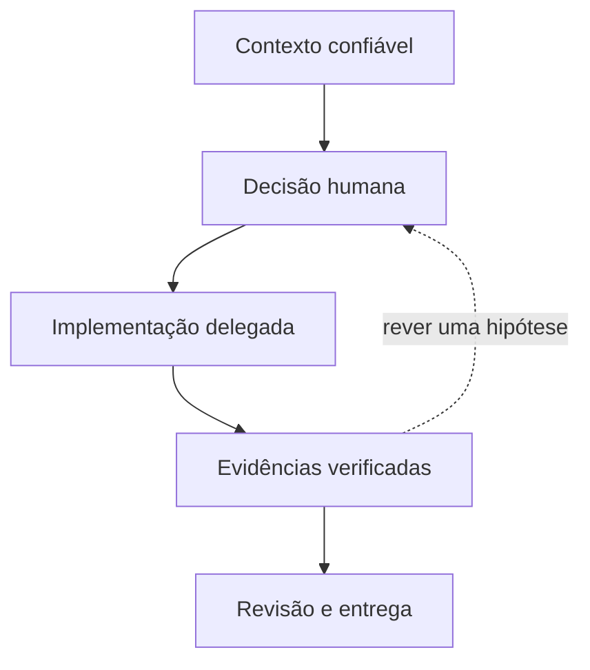

# Exercício concluído

Você entregou melhorias concretas na Luma Gallery:

| Entrega | Onde reconhecer o resultado |
| --- | --- |
| Catálogo ampliado, derivado e sem duplicatas | `PHOTO_TAGS` e `AVAILABLE_TAGS` em `src/lib/mock-tag-data.ts` |
| Sugestões integradas ao Upload | `portrait, wi` oferece `wildlife` na página |
| Seleção por mouse e teclado, com estado acessível | Clique e setas/Enter selecionam; Escape e Tab fecham a lista |
| Skill reutilizável e testes próprios | `.github/skills/test-tags/SKILL.md` e `tests/tag-autocomplete.test.tsx` |
| Pull request revisada e validada | Descrição preenchida e checks aprovados no commit final |

O avanço em relação aos cursos anteriores não está no número de comandos usados. Está em manter a responsabilidade pelas decisões enquanto delega investigação, implementação e verificações ao Copilot.



**O ciclo que você praticou:** fornecer fontes, tomar decisões, delegar uma fatia e conferir o resultado. Quando a evidência contradiz a hipótese, volte à decisão em vez de ajustar o critério para esconder a falha.

## Retome as decisões, não apenas os comandos

| Passo | Decisão praticada | Conceito aplicado |
| --- | --- | --- |
| 1 — Investigar | Distinguir catálogo existente de integração ainda ausente; excluir a seleção de arquivos do escopo | Grounding, busca de contexto e diferença entre `/`, `@` e `#` |
| 2 — Ampliar dados | Acrescentar três tags sem substituir a lista derivada por uma cópia manual | One-shot com invariantes e escolha proporcional do modelo |
| 3 — Planejar | Transformar intenção em critérios e justificar onde ficam estado e fronteira cliente | Step-back prompting e engenharia de contexto |
| 4 — Diagnosticar | Relacionar sintomas a transições sem remover a funcionalidade que falhou | Iteração guiada por ferramentas, hipóteses e evidências |
| 5 — Proteger | Informar ações e resultados antes de gerar os dois testes e conferir suas asserções | Oráculo de teste e skill do projeto invocada por `/test-tags` |
| 6 — Entregar | Julgar achados e comunicar o que os checks não comprovam | Human-in-the-Loop e limites de ferramentas, MCP e delegação |

Você não precisou comparar modelos, registrar conversas ou configurar serviços externos. O plano ficou na conversa da feature; os critérios reutilizáveis ficaram em `.github/skills/test-tags/SKILL.md` e nos testes; a decisão de entrega ficou na PR.

## Confira a conclusão no GitHub

1. A PR vai de `improve-upload` para `main` no seu repositório.
2. O commit final tem **Passo 6** e **CI** aprovados.
3. A issue recebeu **Passo 6 aprovado** e esta revisão.
4. O workflow **Passo 6**, incluindo `finish_exercise`, terminou com sucesso.

> [!IMPORTANT]
> Não é necessário entregar fichas, capturas de conversa ou fazer merge para passar. Antes de decidir pelo merge, confira a descrição da PR e o que ainda não foi verificado. Os checks validam um contrato mínimo; não certificam qualidade completa, segurança ou acessibilidade.

## Leve o processo para a próxima tarefa

Use este roteiro curto como ponto de partida, preenchendo com fontes e critérios do seu projeto:

```text
Objetivo: qual comportamento precisa mudar?
Fontes: quais arquivos e requisitos sustentam a tarefa?
Limites: o que deve permanecer intacto?
Aceite: qual entrada, ação e resultado tornam a entrega verificável?
Validação: quais comandos e interações preciso conferir?
Revisão: quais decisões e limitações devem acompanhar a PR?
```

Não é uma ficha obrigatória nem um novo arquivo para entregar. É uma forma de evitar que a próxima delegação dependa apenas da memória da conversa.

## Extensão opcional para o facilitador

O material `x-extension.md` conduz uma tarefa específica: usar um Space para localizar a cobertura, ler um comentário da PR por GitHub MCP, criar uma issue com dois testes de limpeza do campo e mostrar a PR produzida pelo coding agent. Inclui os pedidos para o Chat, o corpo da issue e os resultados a conferir. A demonstração ocorre na apresentação, sem atividade obrigatória, credenciais compartilhadas ou gate de conclusão.

Reconhecer a função de MCP não equivale a tê-lo configurado ou usado. A prática obrigatória termina na PR; a demonstração apenas mostra como ampliar o mesmo fluxo com contexto compartilhado, acesso externo e delegação.

## Continue praticando

| Para continuar | Documentação oficial |
| --- | --- |
| Melhorar os pedidos e os critérios | [Boas práticas de prompts](https://docs.github.com/en/copilot/get-started/best-practices) |
| Escolher o mecanismo de personalização | [Personalização no VS Code](https://code.visualstudio.com/docs/agent-customization/overview) |
| Selecionar fontes relevantes | [Contexto no Chat](https://code.visualstudio.com/docs/chat/copilot-chat-context) |
| Escolher o modelo disponível | [Modelos e seleção](https://code.visualstudio.com/docs/agent-customization/language-models) |
| Ampliar a revisão de acessibilidade | [Padrão combobox do WAI-ARIA](https://www.w3.org/WAI/ARIA/apg/patterns/combobox/) |
| Reforçar testes de interação | [Testing Library: `user-event`](https://testing-library.com/docs/user-event/intro/) |
| Entender acesso a ferramentas externas | [MCP no VS Code](https://code.visualstudio.com/docs/agent-customization/mcp-servers) |
| Fazer outro exercício guiado | [GitHub Skills](https://skills.github.com/) |

Experimente levar o mesmo processo para uma issue pequena do seu projeto: contexto confiável, entrega observável, testes relevantes e revisão responsável.